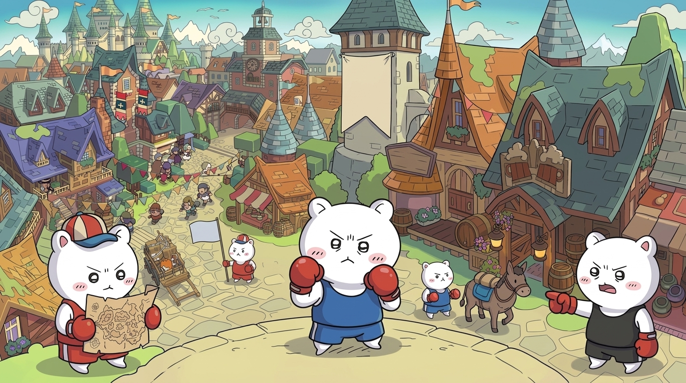

# Clobbertown

> ### 🚧 Work in progress
>
> This is an early prototype, not a finished game. Phase 3 of five is under
> way: you can walk around a town, punch training dummies, and talk to four
> residents who remember what you did, even after a reload, and gossip about
> it to each other. With an API key, Claude writes what they say. Expect
> things to change, break, and get rewritten.

A stylised low-poly brawler set in a small town where every resident remembers
what you did and tells their neighbours about it.

Built for the browser with Three.js, and intended to ship on Steam as a desktop
build later.

## Running it

Requires Node 20 or newer.

```bash
npm install
npm run dev
```

Then open the URL Vite prints, click to play, and use:

| Key | Action |
| --- | --- |
| `W` `A` `S` `D` | Move |
| Mouse | Look around |
| `Shift` | Sprint |
| `Space` | Jump |
| Click / `F` | Punch |
| `E` | Talk to a resident |
| `Esc` | Release the mouse and pause |

The click-to-play screen is not decoration: browsers only grant pointer lock in
response to a real user gesture, so the game cannot capture the mouse on load.

The first load takes a few seconds while Rapier's WebAssembly physics engine
compiles and the models download, around 8MB in total. The overlay says
"Building the town…" until everything is ready, and cannot be clicked through
before then.

### Letting Claude voice the residents

Without any setup, residents speak from short canned lists. Their memory and
gossip still work, and the game is fully playable. To have Claude write what
they say instead:

```bash
cp .env.example .env.local
```

Put an Anthropic API key in `.env.local` and restart `npm run dev`. The corner
of the screen says which mode you are in, and the dev server's terminal logs
the tokens and cache hits behind each line.

The key is read only by the dev server and never reaches the browser.
`.env.local` is gitignored. Each line is one request to `claude-haiku-5-5`, set
in `server/claudeDialogue.ts`. The model is a single constant there; switching
it to `claude-opus-5-5` gives richer lines at about forty times the cost per
token. Rough estimate for Haiku: a fraction of a cent per line. Check the real
figure in the terminal, which logs the tokens each line used.

### What residents remember

Everything residents see is saved to `saves/memory.json` (gitignored) and
survives reloads and restarts. Open it to see exactly what the town knows.
To wipe it and start a playtest over:

```bash
npm run forget
```

### Other commands

```bash
npm test        # run the unit tests
npm run build   # type-check and build for production
npm run typecheck
npm run forget  # make every resident forget everything
```

## Roadmap

| Phase | Scope | Status |
| --- | --- | --- |
| 1 | Third-person character walking around a small town | ✅ Done |
| 2 | Melee combat against dummy targets | ✅ Done |
| 3 | LLM-driven NPCs with persistent memory, and gossip between them | 🚧 In progress |
| 4 | Electron wrapper and a Steam build pipeline via GitHub Actions | ⬜ Not started |
| 5 | Optional co-op or PvP | ⬜ Not started |

Phase 3 is the one the whole design hangs on. The residents' brains run on a
small server inside the Vite dev server (`server/`), because an API key in
browser code is readable by anyone. How that ships in a Steam build is a
Phase 4 decision: a build cannot carry a developer's key, so it needs either a
hosted server or players supplying their own.

## How the code is arranged

```
src/
  config/        Every tuning value and colour, in one place
  scene/         The town: layout data, buildings, ground, lighting
  player/        Character controller, movement maths, follow camera
  input/         Keyboard and pointer-lock handling
  combat/        Punches, dummies, the hit freeze, and who saw what
  npc/           Who lives here, the brain interface, and its implementations
  interaction/   Proximity detection and the talk-to-someone flow
  state/         Zustand store, for UI-facing state only
  ui/            HTML drawn over the 3D scene
server/          The residents' brains: memory, gossip, and dialogue
```

Four decisions are worth knowing before you read anything else.

**All tuning lives in [`src/config/tuning.ts`](src/config/tuning.ts).** Walk
speed, jump height, camera distance, camera smoothing, interaction range. If a
number would change how the game feels, it is in that file and nowhere else, so
the game can be feel-tested by editing one file.

**The NPC interface was the one abstraction built ahead of need.**
[`src/npc/NpcBrain.ts`](src/npc/NpcBrain.ts) was designed in Phase 1 for Phase 3
to slot into, and it did: the game now talks to `RemoteNpcBrain` instead of the
original stub, and nothing that talks to a brain had to change. Two details
existed purely to protect that swap:

- `converse()` returns a `Promise` even though the stub could answer
  synchronously, because a real brain is a network round-trip and a synchronous
  signature would mean rewriting every call site later.
- `observe()` is how the town learns what the player did: every landed punch
  is reported to each resident close enough to see it, with the full list of
  who else saw, which is what gossip spreads. Without it, memory has no way in.

**Who knows what is decided by code, not by the model.**
[`server/knowledge.ts`](server/knowledge.ts) works out what each resident knows
from the log of events and who is friends with whom: news starts with the
witnesses and travels one friend per `GOSSIP.hopDelaySeconds`, credited to
whoever passed it on. Claude is told those facts and only chooses the wording.
That keeps gossip predictable and testable, and stops the model inventing
things the player never did.

**Per-frame state stays out of React.** Input, velocity, player position and
the current animation clip all live in refs, and the Zustand store only holds
things the interface redraws for. Putting a position that changes 60 times a
second into React state would re-render the scene at frame rate for no benefit.

## Testing

The movement maths, animation selection, combat timing, the town layout, and
the brain server's memory, gossip and prompts all have unit tests, so they can
be checked without a browser, a physics world, or an API key. The calls to
Claude are tested against a scripted stand-in, which checks exactly what would
be sent and how every kind of failure falls back, at no cost. The layout tests are worth knowing about: they check that no two
building plots overlap and that nothing is standing in a road, which is tedious
to verify by walking around and easy to break by nudging one number.

```bash
npm test
```

Rendering and physics integration are not unit tested. They are verified by
running the game.

## Art

Stylised low-poly cartoon: chunky proportions, a warm and deliberately small
palette. A toy town, not a simulation.

The buildings and trees are Kenney's City Kit and Nature Kit; the townsfolk are
Quaternius's Ultimate Animated Character Pack. Everything is CC0. The ground,
streets and square are still primitives, since no pack covers them.

Models are not scaled by hand: the layout says how much space a thing should
occupy and the model is fitted to it, and colliders are measured from the
model rather than written out separately. See [`MODELS.md`](MODELS.md) for the
full asset list, the directory layout, and the two material bugs that are
repaired at load time.
